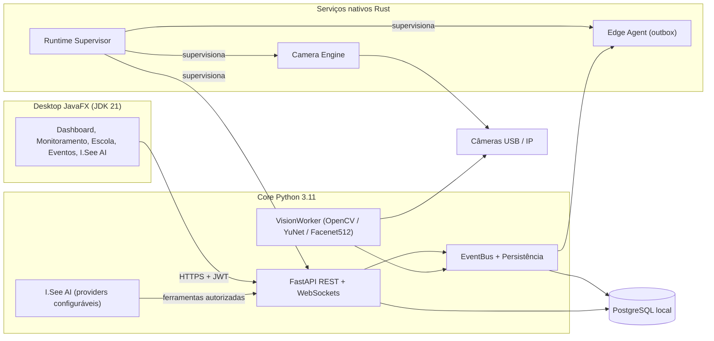

  

<h1 align="center">I.See Enterprise</h1>

  <strong>Plataforma nativa de segurança, monitoramento por câmeras e inteligência operacional — offline-first, multi-tenant e preparada para a LGPD.</strong>

  
  
  
  
  
  

> [!IMPORTANT]
> Este é o **repositório público de apresentação (showcase)** do I.See Enterprise.
> Ele **não contém o código-fonte proprietário**, segredos, credenciais, modelos treinados,
> fotos ou embeddings biométricos. Todos os dados de exemplo em [`demo/`](demo/) são **sintéticos**.

---

## Visão geral

O **I.See Enterprise** é desenvolvido pela **I.See Technologies** para organizações que precisam
operar câmeras, eventos de segurança e controle de presença **localmente**, sem depender de
nuvem, com isolamento entre organizações e controles de privacidade desde a concepção.

| Pilar | O que entrega |
|---|---|
| **Operação offline** | Runtime local completo (PostgreSQL + serviços nativos + API + desktop). Nuvem e IA são opcionais. |
| **Câmeras agnósticas de marca** | USB, RTSP/RTSPS, HTTP/HTTPS, ONVIF e NVR/DVR, com supervisão e reconexão automática. |
| **Visão computacional em CPU** | Detecção e reconhecimento facial sem exigir GPU, com confirmação temporal e deduplicação de eventos. |
| **Multi-tenant** | Hierarquia `Organization → Unit → Area`, com RBAC aplicado no backend. |
| **Privacidade (LGPD)** | Biometria opcional, minimização, retenção configurável e alternativas não biométricas para serviços essenciais. |
| **I.See AI** | Assistente operacional multi-provider (inclusive IA local) restrito a ferramentas autorizadas e auditadas. |

## Verticais

- **I.See Corporate** — organizações, unidades, áreas, usuários, permissões, câmeras, eventos,
  incidentes, relatórios e auditoria operacional.
- **I.See School** — alunos, turmas, unidades escolares, presença, histórico, correção manual auditável
  e relatórios agregados de presença para apoio ao **planejamento da alimentação escolar**.
  O reconhecimento facial **nunca** é requisito para o acesso de estudantes a serviços essenciais.

Ambas compartilham o mesmo núcleo (backend único) e diferem em regras de negócio e interfaces.
Detalhes em [docs/MODULES.md](docs/MODULES.md).

## Arquitetura (alto nível)

Mais detalhes em [docs/ARCHITECTURE.md](docs/ARCHITECTURE.md).

## Stack tecnológica

| Camada | Tecnologias |
|---|---|
| Backend | Python 3.11, FastAPI, Uvicorn, SQLAlchemy, Alembic, PostgreSQL, REST, WebSockets, JWT + RBAC |
| Nativo | Rust (Camera Engine, Edge Agent, Runtime Supervisor) |
| Visão | OpenCV, YuNet, DeepFace / Facenet512 (execução em CPU) |
| Desktop | Java 21, JavaFX, Maven, jpackage, WiX Toolset |
| Distribuição | Instalador Windows nativo; Linux com systemd (em preparação) |

## Qualidade de engenharia

Resultados **medidos** na base de código privada (novembro/2026):

| Suíte | Resultado |
|---|---|
| Backend (pytest) | 385 aprovados, 3 ignorados (dependem de PostgreSQL/Windows dedicados) |
| Serviços nativos (cargo test) | 19 aprovados |
| Desktop (Maven/JUnit) | 37 aprovados |

Metodologia e limites em [docs/ENGINEERING.md](docs/ENGINEERING.md).

> [!NOTE]
> Não publicamos números de precisão biométrica: eles só serão divulgados após avaliação com
> conjunto de dados apropriado, consentimento e protocolo documentado.

## Segurança e privacidade

Resumo da postura de segurança, LGPD e tratamento de dados de crianças e adolescentes em
[docs/SECURITY_AND_PRIVACY.md](docs/SECURITY_AND_PRIVACY.md).

Encontrou um problema de segurança? Veja [SECURITY.md](SECURITY.md).

## Dados de demonstração

A pasta [`demo/`](demo/) contém respostas de API **sintéticas** que ilustram os contratos públicos
(status de câmeras, presença escolar e planejamento de alimentação). Nenhum dado real de pessoas.

## Roadmap

Consulte [docs/ROADMAP.md](docs/ROADMAP.md).

## Licença

Software **proprietário** — © 2026 I.See Technologies. Todos os direitos reservados.
Consulte [LICENSE.md](LICENSE.md). Este repositório é apenas informativo.
